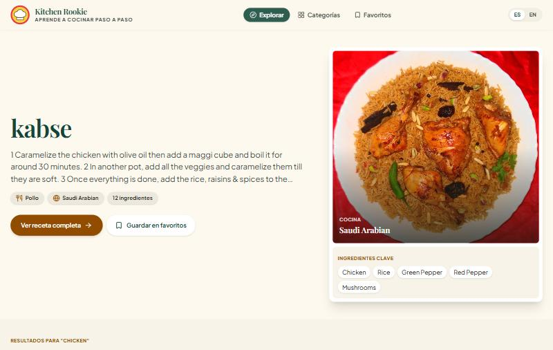
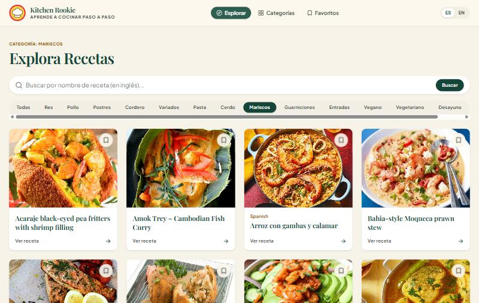
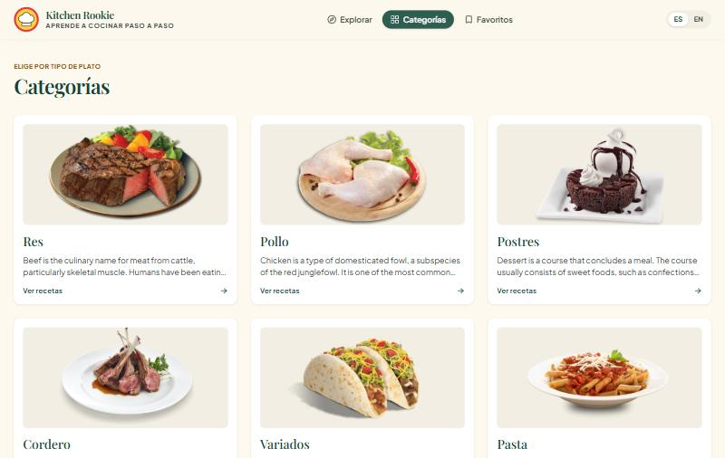
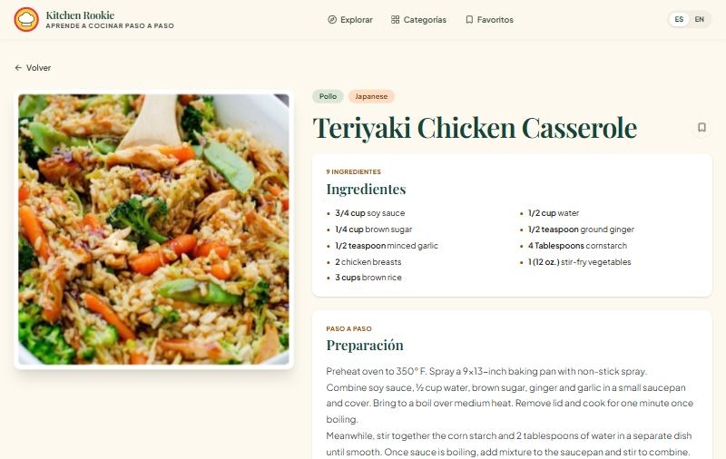
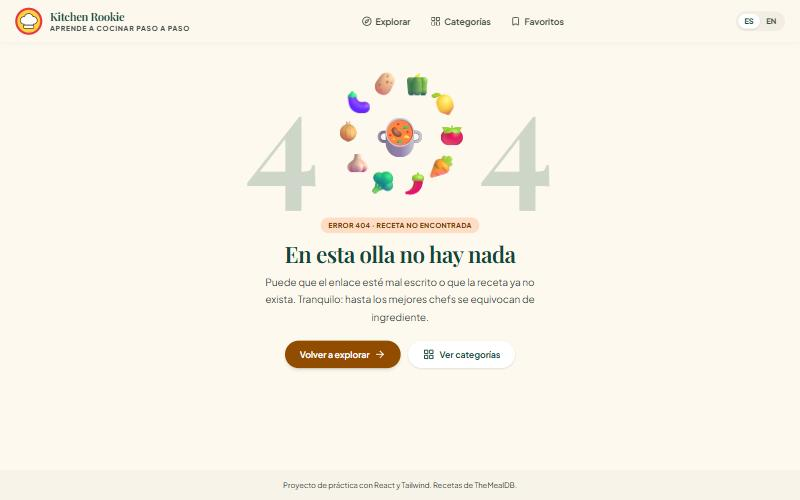
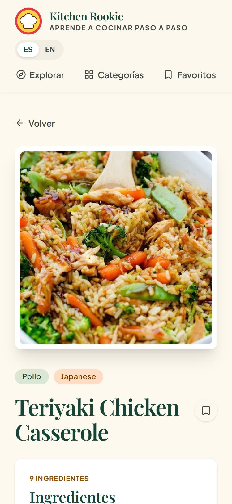

<p align="center">
  
</p>

<h1 align="center">Kitchen Rookie</h1>

<p align="center">
  A recipe app for people who are learning to cook.<br />
  Search dishes, browse categories, save your favorites and read every step in Spanish or English.
</p>

<p align="center">
  
  
  
  
</p>



## About

Kitchen Rookie is a learning project built step by step to practice React. It consumes the free [TheMealDB](https://www.themealdb.com/api.php) API and focuses on the things a real app needs beyond the happy path: loading states, empty results, invalid URLs, responsive layouts and accessibility.

## Features

- **Featured recipe**: every visit to the home page shows a random recipe to practice, with its key ingredients.
- **Search**: find recipes by name. The search lives in the URL (`/?q=tacos`), so it survives reloads, the back button and shared links.
- **Categories**: a dedicated page with every category, plus quick filter tabs on the explore page (`/?c=Seafood`).
- **Recipe detail**: ingredients with measurements and step-by-step instructions, with the photo pinned on desktop while you read.
- **Favorites**: save recipes with one click. They are stored in `localStorage`, so they stay after closing the browser.
- **Spanish and English**: the whole interface, including category names, can be switched with the ES / EN toggle. The language choice is remembered.
- **Skeleton loaders**: placeholders with the shape of the real content instead of a plain "Loading..." text.
- **Custom 404 page**: an animated ring of ingredients around an empty pot, shown for unknown routes and for recipes that do not exist.
- **Responsive**: designed mobile-first, from 375 px phones to wide desktop screens.

## Screenshots

<table>
  <tr>
    <td width="50%"></td>
    <td width="50%"></td>
  </tr>
  <tr>
    <td align="center"><b>Explore</b>: search and category filter</td>
    <td align="center"><b>Categories</b>: pick by type of dish</td>
  </tr>
  <tr>
    <td width="50%"></td>
    <td width="50%"></td>
  </tr>
  <tr>
    <td align="center"><b>Recipe detail</b>: ingredients and preparation</td>
    <td align="center"><b>404</b>: "There's nothing in this pot"</td>
  </tr>
</table>

<p align="center">
  
  <br />
  <b>Mobile</b>
</p>

## Tech stack

| Tool | Used for |
|---|---|
| [React 19](https://react.dev/) | UI components, hooks and Context |
| [React Router 7](https://reactrouter.com/) | Pages, URL parameters and search params |
| [Tailwind CSS 4](https://tailwindcss.com/) | Styling, with the color palette and fonts defined as design tokens |
| [Vite](https://vite.dev/) | Development server and production build |
| [Lucide](https://lucide.dev/) | Icons |
| [TheMealDB](https://www.themealdb.com/) | Recipe data |

## Getting started

You need [Node.js](https://nodejs.org/) 20.19 or newer.

```bash
git clone https://github.com/axelgolin4/Kitchen-Rookie.git
cd Kitchen-Rookie
npm install
npm run dev
```

Then open [http://localhost:5173](http://localhost:5173). No API key or environment variables are needed: TheMealDB offers a free public key for learning projects.

### Available scripts

| Command | What it does |
|---|---|
| `npm run dev` | Starts the development server with hot reload |
| `npm run build` | Creates an optimized production build in `dist/` |
| `npm run preview` | Serves the production build locally |
| `npm run lint` | Checks the code with ESLint |

## Project structure

```
src/
├── components/      Reusable UI pieces (RecipeCard, SearchBar, Hero, ...)
├── context/         Global state shared with Context
│   ├── FavoritesContext.jsx
│   └── LanguageContext.jsx
├── hooks/           Custom hooks
│   ├── useFetch.js          Fetches a URL and returns { data, loading, error }
│   └── useLocalStorage.js   useState that persists in localStorage
├── i18n/
│   └── translations.js      Spanish and English texts
├── pages/           One component per route
│   ├── Home.jsx             /            (and /?q=... or /?c=...)
│   ├── Categories.jsx       /categories
│   ├── Favorites.jsx        /favorites
│   ├── RecipeDetail.jsx     /recipe/:id
│   └── NotFound.jsx         any other route
├── utils/
│   └── recipe.js            Helpers to work with TheMealDB data
├── App.jsx          Layout (header, footer) and routes
├── main.jsx         Entry point with the router and providers
└── index.css        Tailwind import and design tokens
```

## What I practiced

- **Components and props**, with data flowing down and events flowing up through callbacks.
- **Custom hooks**: `useFetch` removed the repeated request logic from every page, and `useLocalStorage` gives favorites and language persistence.
- **Derived state**: the loading flag is calculated from the current URL instead of being stored separately, so it can never get out of sync.
- **Effect cleanup** to ignore responses that arrive late, avoiding race conditions when searching quickly.
- **The URL as the source of truth** for search and category filters, using `useSearchParams`.
- **Context** for state that many components need (favorites, language) without passing props through every level.
- **A small i18n system** with interpolation (`t("ingredients.count", { n: 8 })`). Only the displayed text is translated; requests to the API keep using the original category names.
- **Defensive data handling**: the API returns `null` when nothing is found and even a string (`"Invalid ID"`) for malformed IDs, so the code checks the shape of the data before using it.
- **Design tokens** in Tailwind 4 with `@theme`, plus modern CSS like `clamp()`, `:has()` and `prefers-reduced-motion`.

<p align="center">
  <a href="https://kitchen-rookie.vercel.app/"><b>Live demo →</b></a>
</p>


## Credits

- Recipe data and images from [TheMealDB](https://www.themealdb.com/).
- Icons from [Lucide](https://lucide.dev/).
- Fonts: [Playfair Display](https://fonts.google.com/specimen/Playfair+Display) and [Plus Jakarta Sans](https://fonts.google.com/specimen/Plus+Jakarta+Sans) from Google Fonts.


